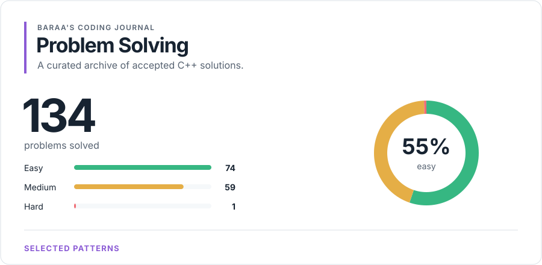

<!-- Generated by .github/scripts/update_readme.py. Edit the generator to change this README. -->

<a href="https://leetcode.com/u/bali19/">LeetCode profile ↗</a>

<strong>Browse all 134 solutions</strong>

## Solution catalog

LeetCode and NeetCode solutions, organized by difficulty and problem pattern.

---

### 🟢 Easy (74 Problems)

| # | Problem | Category / Pattern | Solution |
| :-: | :--- | :--- | :-: |
| 1 | [Baseball Game](<Data Structures & Algorithms/baseball-game>) | Stack / Simulation | [C++](<Data Structures & Algorithms/baseball-game/submission-0.cpp>) |
| 2 | [Binary Search](<Data Structures & Algorithms/binary-search>) | Array / Binary Search | [C++](<Data Structures & Algorithms/binary-search/submission-0.cpp>) |
| 3 | [Can Place Flowers](<Data Structures & Algorithms/can-place-flowers>) | Array / Greedy | [C++](<Data Structures & Algorithms/can-place-flowers/submission-1.cpp>) |
| 4 | [Check if Array Is Sorted and Rotated](<Data Structures & Algorithms/check-if-array-is-sorted-and-rotated>) | Array | [C++](<Data Structures & Algorithms/check-if-array-is-sorted-and-rotated/submission-0.cpp>) |
| 5 | [Climbing Stairs](<Data Structures & Algorithms/climbing-stairs>) | Math / Dynamic Programming | [C++](<Data Structures & Algorithms/climbing-stairs/submission-2.cpp>) |
| 6 | [Concatenation of Array](<Data Structures & Algorithms/concatenation-of-array>) | Array | [C++](<Data Structures & Algorithms/concatenation-of-array/submission-0.cpp>) |
| 7 | [Confusing Number](<Data Structures & Algorithms/confusing-number>) | Math / Hash Table | [C++](<Data Structures & Algorithms/confusing-number/submission-0.cpp>) |
| 8 | [Count the Number of Consistent Strings](<Data Structures & Algorithms/count-the-number-of-consistent-strings>) | Array / Hash Table | [C++](<Data Structures & Algorithms/count-the-number-of-consistent-strings/submission-0.cpp>) |
| 9 | [Counting Elements](<Data Structures & Algorithms/counting-elements>) | Hash Set / Counting | [C++](<Data Structures & Algorithms/counting-elements/submission-1.cpp>) |
| 10 | [Design HashSet](<Data Structures & Algorithms/design-hashset>) | Array / Hash Table | [C++](<Data Structures & Algorithms/design-hashset/submission-0.cpp>) |
| 11 | [Divide Array Into Equal Pairs](<Data Structures & Algorithms/divide-array-into-equal-pairs>) | Array / Hash Table | [C++](<Data Structures & Algorithms/divide-array-into-equal-pairs/submission-0.cpp>) |
| 12 | [Duplicate Integer](<Data Structures & Algorithms/duplicate-integer>) | Hash Set (Contains Duplicate) | [C++](<Data Structures & Algorithms/duplicate-integer/submission-0.cpp>) |
| 13 | [Find Anagram Mappings](<Data Structures & Algorithms/find-anagram-mappings>) | Hash Map | [C++](<Data Structures & Algorithms/find-anagram-mappings/submission-0.cpp>) |
| 14 | [Find Lucky Integer in an Array](<Data Structures & Algorithms/find-lucky-integer-in-an-array>) | Array / Hash Table | [C++](<Data Structures & Algorithms/find-lucky-integer-in-an-array/submission-0.cpp>) |
| 15 | [Find Pivot Index](<Data Structures & Algorithms/find-pivot-index>) | Array / Prefix Sum | [C++](<Data Structures & Algorithms/find-pivot-index/submission-0.cpp>) |
| 16 | [Find Target Indices After Sorting Array](<2089-find-target-indices-after-sorting-array>) | Array / Binary Search | [C++](<2089-find-target-indices-after-sorting-array/solution.cpp>) |
| 17 | [Find Words That Can Be Formed by Characters](<Data Structures & Algorithms/find-words-that-can-be-formed-by-characters>) | Array / Hash Table | [C++](<Data Structures & Algorithms/find-words-that-can-be-formed-by-characters/submission-0.cpp>) |
| 18 | [Height Checker](<Data Structures & Algorithms/height-checker>) | Array / Sorting | [C++](<Data Structures & Algorithms/height-checker/submission-0.cpp>) |
| 19 | [Implement Stack using Queues](<Data Structures & Algorithms/implement-stack-using-queues>) | Stack / Design | [C++](<Data Structures & Algorithms/implement-stack-using-queues/submission-0.cpp>) |
| 20 | [Is Anagram](<Data Structures & Algorithms/is-anagram>) | Hash Table / String | [C++](<Data Structures & Algorithms/is-anagram/submission-1.cpp>) |
| 21 | [Is Palindrome](<Data Structures & Algorithms/is-palindrome>) | Two Pointers / String | [C++](<Data Structures & Algorithms/is-palindrome/submission-1.cpp>) |
| 22 | [Is Subsequence](<Data Structures & Algorithms/is-subsequence>) | Two Pointers | [C++](<Data Structures & Algorithms/is-subsequence/submission-0.cpp>) |
| 23 | [Isomorphic Strings](<Data Structures & Algorithms/isomorphic-strings>) | Hash Table / String | [C++](<Data Structures & Algorithms/isomorphic-strings/submission-0.cpp>) |
| 24 | [Kth Distinct String in an Array](<Data Structures & Algorithms/kth-distinct-string-in-an-array>) | Array / Hash Table | [C++](<Data Structures & Algorithms/kth-distinct-string-in-an-array/submission-1.cpp>) |
| 25 | [Largest Substring Between Two Equal Characters](<Data Structures & Algorithms/largest-substring-between-two-equal-characters>) | Hash Table / String | [C++](<Data Structures & Algorithms/largest-substring-between-two-equal-characters/submission-0.cpp>) |
| 26 | [Largest Unique Number](<Data Structures & Algorithms/largest-unique-number>) | Hash Map / Counting | [C++](<Data Structures & Algorithms/largest-unique-number/submission-0.cpp>) |
| 27 | [Length of Last Word](<Data Structures & Algorithms/length-of-last-word>) | String Manipulation | [C++](<Data Structures & Algorithms/length-of-last-word/submission-0.cpp>) |
| 28 | [Longest Common Prefix](<Data Structures & Algorithms/longest-common-prefix>) | Array / String | [C++](<Data Structures & Algorithms/longest-common-prefix/submission-0.cpp>) |
| 29 | [Longest Palindrome](<Data Structures & Algorithms/longest-palindrome>) | Hash Table / String | [C++](<Data Structures & Algorithms/longest-palindrome/submission-4.cpp>) |
| 30 | [Longest Strictly Increasing or Strictly Decreasing Subarray](<Data Structures & Algorithms/longest-strictly-increasing-or-strictly-decreasing-subarray>) | Array | [C++](<Data Structures & Algorithms/longest-strictly-increasing-or-strictly-decreasing-subarray/submission-0.cpp>) |
| 31 | [Max Consecutive Ones](<Data Structures & Algorithms/max-consecutive-ones>) | Array / Sliding Window | [C++](<Data Structures & Algorithms/max-consecutive-ones/submission-0.cpp>) |
| 32 | [Maximum Ascending Subarray Sum](<Data Structures & Algorithms/maximum-ascending-subarray-sum>) | Array | [C++](<Data Structures & Algorithms/maximum-ascending-subarray-sum/submission-0.cpp>) |
| 33 | [Maximum Difference Between Even and Odd Frequency I](<Data Structures & Algorithms/maximum-difference-between-even-and-odd-frequency-i>) | Hash Table / String | [C++](<Data Structures & Algorithms/maximum-difference-between-even-and-odd-frequency-i/submission-0.cpp>) |
| 34 | [Maximum Number of Balloons](<Data Structures & Algorithms/maximum-number-of-balloons>) | Hash Table / String | [C++](<Data Structures & Algorithms/maximum-number-of-balloons/submission-0.cpp>) |
| 35 | [Maximum Product Difference Between Two Pairs](<Data Structures & Algorithms/maximum-product-difference-between-two-pairs>) | Array / Sorting | [C++](<Data Structures & Algorithms/maximum-product-difference-between-two-pairs/submission-1.cpp>) |
| 36 | [Merge Sorted Array](<Data Structures & Algorithms/merge-sorted-array>) | Two Pointers | [C++](<Data Structures & Algorithms/merge-sorted-array/submission-0.cpp>) |
| 37 | [Merge Strings Alternately](<Data Structures & Algorithms/merge-strings-alternately>) | Two Pointers / String | [C++](<Data Structures & Algorithms/merge-strings-alternately/submission-0.cpp>) |
| 38 | [Merge Two 2D Arrays by Summing Values](<Data Structures & Algorithms/merge-two-2d-arrays-by-summing-values>) | Array / Hash Table | [C++](<Data Structures & Algorithms/merge-two-2d-arrays-by-summing-values/submission-0.cpp>) |
| 39 | [Merge Two Sorted Linked Lists](<Data Structures & Algorithms/merge-two-sorted-linked-lists>) | Linked List / Two Pointers | [C++](<Data Structures & Algorithms/merge-two-sorted-linked-lists/submission-0.cpp>) |
| 40 | [Minimum Changes To Make Alternating Binary String](<Data Structures & Algorithms/minimum-changes-to-make-alternating-binary-string>) | String | [C++](<Data Structures & Algorithms/minimum-changes-to-make-alternating-binary-string/submission-0.cpp>) |
| 41 | [Monotonic Array](<Data Structures & Algorithms/monotonic-array>) | Array | [C++](<Data Structures & Algorithms/monotonic-array/submission-0.cpp>) |
| 42 | [Move Zeroes](<Data Structures & Algorithms/move-zeroes>) | Array / Two Pointers | [C++](<Data Structures & Algorithms/move-zeroes/submission-0.cpp>) |
| 43 | [Moving Average from Data Stream](<Data Structures & Algorithms/moving-average-from-data-stream>) | Queue / Design | [C++](<Data Structures & Algorithms/moving-average-from-data-stream/submission-0.cpp>) |
| 44 | [Next Greater Element I](<Data Structures & Algorithms/next-greater-element-i>) | Array / Hash Table | [C++](<Data Structures & Algorithms/next-greater-element-i/submission-0.cpp>) |
| 45 | [Number of Good Pairs](<Data Structures & Algorithms/number-of-good-pairs>) | Array / Hash Table | [C++](<Data Structures & Algorithms/number-of-good-pairs/submission-0.cpp>) |
| 46 | [Number of Senior Citizens](<Data Structures & Algorithms/number-of-senior-citizens>) | Array / String | [C++](<Data Structures & Algorithms/number-of-senior-citizens/submission-0.cpp>) |
| 47 | [Number of Students Unable to Eat Lunch](<Data Structures & Algorithms/number-of-students-unable-to-eat-lunch>) | Array / Stack | [C++](<Data Structures & Algorithms/number-of-students-unable-to-eat-lunch/submission-1.cpp>) |
| 48 | [Palindrome Permutation](<Data Structures & Algorithms/palindrome-permutation>) | Hash Set / Bitmask | [C++](<Data Structures & Algorithms/palindrome-permutation/submission-0.cpp>) |
| 49 | [Path Crossing](<Data Structures & Algorithms/path-crossing>) | Hash Table / String | [C++](<Data Structures & Algorithms/path-crossing/submission-2.cpp>) |
| 50 | [Perform String Shifts](<Data Structures & Algorithms/perform-string-shifts>) | String / Math | [C++](<Data Structures & Algorithms/perform-string-shifts/submission-0.cpp>) |
| 51 | [Range Sum Query - Immutable](<Data Structures & Algorithms/range-sum-query-immutable>) | Array / Design | [C++](<Data Structures & Algorithms/range-sum-query-immutable/submission-1.cpp>) |
| 52 | [Ransom Note](<Data Structures & Algorithms/ransom-note>) | Hash Table / String | [C++](<Data Structures & Algorithms/ransom-note/submission-0.cpp>) |
| 53 | [Redistribute Characters to Make All Strings Equal](<Data Structures & Algorithms/redistribute-characters-to-make-all-strings-equal>) | Hash Table / String | [C++](<Data Structures & Algorithms/redistribute-characters-to-make-all-strings-equal/submission-2.cpp>) |
| 54 | [Remove Duplicates from Sorted Array](<Data Structures & Algorithms/remove-duplicates-from-sorted-array>) | Array / Two Pointers | [C++](<Data Structures & Algorithms/remove-duplicates-from-sorted-array/submission-0.cpp>) |
| 55 | [Remove Element](<Data Structures & Algorithms/remove-element>) | Two Pointers / Array | [C++](<Data Structures & Algorithms/remove-element/submission-0.cpp>) |
| 56 | [Replace Elements with Greatest Element on Right Side](<Data Structures & Algorithms/replace-elements-with-greatest-element-on-right-side>) | Array / Traversal from Right | [C++](<Data Structures & Algorithms/replace-elements-with-greatest-element-on-right-side/submission-0.cpp>) |
| 57 | [Reverse a Linked List](<Data Structures & Algorithms/reverse-a-linked-list>) | Linked List | [C++](<Data Structures & Algorithms/reverse-a-linked-list/submission-1.cpp>) |
| 58 | [Reverse String](<Data Structures & Algorithms/reverse-string>) | Two Pointers / String | [C++](<Data Structures & Algorithms/reverse-string/submission-0.cpp>) |
| 59 | [Score of a String](<Data Structures & Algorithms/score-of-a-string>) | String / Math | [C++](<Data Structures & Algorithms/score-of-a-string/submission-0.cpp>) |
| 60 | [Sentence Similarity](<Data Structures & Algorithms/sentence-similarity>) | Hash Set / Map | [C++](<Data Structures & Algorithms/sentence-similarity/submission-0.cpp>) |
| 61 | [Set Mismatch](<Data Structures & Algorithms/set-mismatch>) | Array / Hash Table | [C++](<Data Structures & Algorithms/set-mismatch/submission-3.cpp>) |
| 62 | [Single-Row Keyboard](<Data Structures & Algorithms/single-row-keyboard>) | Hash Map / String | [C++](<Data Structures & Algorithms/single-row-keyboard/submission-0.cpp>) |
| 63 | [Special Array I](<Data Structures & Algorithms/special-array-i>) | Array | [C++](<Data Structures & Algorithms/special-array-i/submission-0.cpp>) |
| 64 | [Squares of a Sorted Array](<Data Structures & Algorithms/squares-of-a-sorted-array>) | Array / Two Pointers | [C++](<Data Structures & Algorithms/squares-of-a-sorted-array/submission-0.cpp>) |
| 65 | [String Matching in an Array](<Data Structures & Algorithms/string-matching-in-an-array>) | Array / String | [C++](<Data Structures & Algorithms/string-matching-in-an-array/submission-0.cpp>) |
| 66 | [Subarrays Distinct Element Sum of Squares I](<2913-subarrays-distinct-element-sum-of-squares-i>) | Array / Hash Table | [C++](<2913-subarrays-distinct-element-sum-of-squares-i/solution.cpp>) |
| 67 | [Time Needed to Buy Tickets](<Data Structures & Algorithms/time-needed-to-buy-tickets>) | Array / Queue | [C++](<Data Structures & Algorithms/time-needed-to-buy-tickets/submission-0.cpp>) |
| 68 | [Two Sum](<0001-two-sum>) | Array / Hash Table | [C++](<0001-two-sum/solution.cpp>) |
| 69 | [Valid Palindrome II](<Data Structures & Algorithms/valid-palindrome-ii>) | Two Pointers / Greedy | [C++](<Data Structures & Algorithms/valid-palindrome-ii/submission-1.cpp>) |
| 70 | [Valid Parentheses](<0020-valid-parentheses>) | String / Stack | [C++](<0020-valid-parentheses/solution.cpp>) |
| 71 | [Valid Word Abbreviation](<Data Structures & Algorithms/valid-word-abbreviation>) | Two Pointers / String | [C++](<Data Structures & Algorithms/valid-word-abbreviation/submission-0.cpp>) |
| 72 | [Valid Word Square](<Data Structures & Algorithms/valid-word-square>) | Matrix / String | [C++](<Data Structures & Algorithms/valid-word-square/submission-1.cpp>) |
| 73 | [Validate Parentheses](<Data Structures & Algorithms/validate-parentheses>) | Stack | [C++](<Data Structures & Algorithms/validate-parentheses/submission-0.cpp>) |
| 74 | [Word Pattern](<Data Structures & Algorithms/word-pattern>) | Hash Table / String | [C++](<Data Structures & Algorithms/word-pattern/submission-0.cpp>) |

---

### 🟡 Medium (59 Problems)

| # | Problem | Category / Pattern | Solution |
| :-: | :--- | :--- | :-: |
| 1 | [3Sum](<Data Structures & Algorithms/three-integer-sum>) | Array / Two Pointers | [C++](<Data Structures & Algorithms/three-integer-sum/submission-0.cpp>) |
| 2 | [Adding Spaces to a String](<Data Structures & Algorithms/adding-spaces-to-a-string>) | Array / Two Pointers | [C++](<Data Structures & Algorithms/adding-spaces-to-a-string/submission-0.cpp>) |
| 3 | [Append Characters to String to Make Subsequence](<Data Structures & Algorithms/append-characters-to-string-to-make-subsequence>) | Two Pointers / Greedy | [C++](<Data Structures & Algorithms/append-characters-to-string-to-make-subsequence/submission-0.cpp>) |
| 4 | [Average Waiting Time](<Data Structures & Algorithms/average-waiting-time>) | Array / Simulation | [C++](<Data Structures & Algorithms/average-waiting-time/submission-0.cpp>) |
| 5 | [Brick Wall](<Data Structures & Algorithms/brick-wall>) | Array / Hash Table | [C++](<Data Structures & Algorithms/brick-wall/submission-1.cpp>) |
| 6 | [Container With Most Water](<Data Structures & Algorithms/max-water-container>) | Array / Two Pointers | [C++](<Data Structures & Algorithms/max-water-container/submission-0.cpp>) |
| 7 | [Continuous Subarray Sum](<Data Structures & Algorithms/continuous-subarray-sum>) | Array / Hash Table | [C++](<Data Structures & Algorithms/continuous-subarray-sum/submission-0.cpp>) |
| 8 | [Count Number of Bad Pairs](<2364-count-number-of-bad-pairs>) | Array / Hash Table | [C++](<2364-count-number-of-bad-pairs/solution.cpp>) |
| 9 | [Count Pairs in Two Arrays](<Data Structures & Algorithms/count-pairs-in-two-arrays>) | Array / Two Pointers | [C++](<Data Structures & Algorithms/count-pairs-in-two-arrays/submission-2.cpp>) |
| 10 | [Count Vowel Strings in Ranges](<Data Structures & Algorithms/count-vowel-strings-in-ranges>) | Array / String | [C++](<Data Structures & Algorithms/count-vowel-strings-in-ranges/submission-0.cpp>) |
| 11 | [Custom Sort String](<Data Structures & Algorithms/custom-sort-string>) | Hash Table / String | [C++](<Data Structures & Algorithms/custom-sort-string/submission-0.cpp>) |
| 12 | [Design Browser History](<Data Structures & Algorithms/design-browser-history>) | Array / Linked List | [C++](<Data Structures & Algorithms/design-browser-history/submission-0.cpp>) |
| 13 | [Design Linked List](<0707-design-linked-list>) | Linked List / Design | [C++](<0707-design-linked-list/solution.cpp>) |
| 14 | [Elements in Array After Removing and Replacing Elements](<Data Structures & Algorithms/elements-in-array-after-removing-and-replacing-elements>) | Array | [C++](<Data Structures & Algorithms/elements-in-array-after-removing-and-replacing-elements/submission-0.cpp>) |
| 15 | [Encode and Decode Strings](<Data Structures & Algorithms/string-encode-and-decode>) | Array / String | [C++](<Data Structures & Algorithms/string-encode-and-decode/submission-1.cpp>) |
| 16 | [Find All Duplicates in an Array](<0442-find-all-duplicates-in-an-array>) | Array / Hash Table | [C++](<0442-find-all-duplicates-in-an-array/solution.cpp>) |
| 17 | [Find Smallest Common Element in All Rows](<Data Structures & Algorithms/find-smallest-common-element-in-all-rows>) | Matrix / Counting / Binary Search | [C++](<Data Structures & Algorithms/find-smallest-common-element-in-all-rows/submission-2.cpp>) |
| 18 | [Find the Duplicate Number](<Data Structures & Algorithms/find-duplicate-integer>) | Array / Two Pointers | [C++](<Data Structures & Algorithms/find-duplicate-integer/submission-0.cpp>) |
| 19 | [First Unique Number](<Data Structures & Algorithms/first-unique-number>) | Array / Hash Table | [C++](<Data Structures & Algorithms/first-unique-number/submission-1.cpp>) |
| 20 | [Grid Game](<Data Structures & Algorithms/grid-game>) | Array / Matrix | [C++](<Data Structures & Algorithms/grid-game/submission-1.cpp>) |
| 21 | [Group Anagrams](<Data Structures & Algorithms/anagram-groups>) | Array / Hash Table | [C++](<Data Structures & Algorithms/anagram-groups/submission-0.cpp>) |
| 22 | [Koko Eating Bananas](<Data Structures & Algorithms/eating-bananas>) | Array / Binary Search | [C++](<Data Structures & Algorithms/eating-bananas/submission-0.cpp>) |
| 23 | [Largest Number](<Data Structures & Algorithms/largest-number>) | Array / String | [C++](<Data Structures & Algorithms/largest-number/submission-1.cpp>) |
| 24 | [Lonely Pixel I](<Data Structures & Algorithms/lonely-pixel-i>) | Matrix / Hash Table / Counting | [C++](<Data Structures & Algorithms/lonely-pixel-i/submission-0.cpp>) |
| 25 | [Longest Common Subsequence Between Sorted Arrays](<Data Structures & Algorithms/longest-common-subsequence-between-sorted-arrays>) | Array / Hash Table | [C++](<Data Structures & Algorithms/longest-common-subsequence-between-sorted-arrays/submission-0.cpp>) |
| 26 | [Longest Consecutive Sequence](<Data Structures & Algorithms/longest-consecutive-sequence>) | Array / Hash Table | [C++](<Data Structures & Algorithms/longest-consecutive-sequence/submission-0.cpp>) |
| 27 | [Make Sum Divisible by P](<Data Structures & Algorithms/make-sum-divisible-by-p>) | Array / Hash Table | [C++](<Data Structures & Algorithms/make-sum-divisible-by-p/submission-3.cpp>) |
| 28 | [Maximize Sum of Squares of Digits](<3723-maximize-sum-of-squares-of-digits>) | Math / Greedy | [C++](<3723-maximize-sum-of-squares-of-digits/solution.cpp>) |
| 29 | [Maximum Distance in Arrays](<Data Structures & Algorithms/maximum-distance-in-arrays>) | Greedy / Array | [C++](<Data Structures & Algorithms/maximum-distance-in-arrays/submission-0.cpp>) |
| 30 | [Maximum Number of People That Can Be Caught in Tag](<Data Structures & Algorithms/maximum-number-of-people-that-can-be-caught-in-tag>) | Array / Two Pointers | [C++](<Data Structures & Algorithms/maximum-number-of-people-that-can-be-caught-in-tag/submission-0.cpp>) |
| 31 | [Maximum Sum Score of Array](<Data Structures & Algorithms/maximum-sum-score-of-array>) | Array / Prefix Sum | [C++](<Data Structures & Algorithms/maximum-sum-score-of-array/submission-2.cpp>) |
| 32 | [Minimum Index of a Valid Split](<Data Structures & Algorithms/minimum-index-of-a-valid-split>) | Array / Hash Table | [C++](<Data Structures & Algorithms/minimum-index-of-a-valid-split/submission-0.cpp>) |
| 33 | [Minimum Number of Operations to Make Array Empty](<Data Structures & Algorithms/minimum-number-of-operations-to-make-array-empty>) | Array / Hash Table | [C++](<Data Structures & Algorithms/minimum-number-of-operations-to-make-array-empty/submission-1.cpp>) |
| 34 | [Minimum Number of Swaps to Make the String Balanced](<Data Structures & Algorithms/minimum-number-of-swaps-to-make-the-string-balanced>) | Two Pointers / String | [C++](<Data Structures & Algorithms/minimum-number-of-swaps-to-make-the-string-balanced/submission-0.cpp>) |
| 35 | [Minimum Operations to Sort a String](<3863-minimum-operations-to-sort-a-string>) | String | [C++](<3863-minimum-operations-to-sort-a-string/solution.cpp>) |
| 36 | [Minimum Remove to Make Valid Parentheses](<Data Structures & Algorithms/minimum-remove-to-make-valid-parentheses>) | String / Stack | [C++](<Data Structures & Algorithms/minimum-remove-to-make-valid-parentheses/submission-0.cpp>) |
| 37 | [Minimum Stack](<Data Structures & Algorithms/minimum-stack>) | Stack / Design | [C++](<Data Structures & Algorithms/minimum-stack/submission-0.cpp>) |
| 38 | [Number of Sub-arrays With Odd Sum](<Data Structures & Algorithms/number-of-sub-arrays-with-odd-sum>) | Array / Math | [C++](<Data Structures & Algorithms/number-of-sub-arrays-with-odd-sum/submission-0.cpp>) |
| 39 | [Number of Subsequences That Satisfy the Given Sum Condition](<Data Structures & Algorithms/number-of-subsequences-that-satisfy-the-given-sum-condition>) | Array / Two Pointers | [C++](<Data Structures & Algorithms/number-of-subsequences-that-satisfy-the-given-sum-condition/submission-3.cpp>) |
| 40 | [One Edit Distance](<Data Structures & Algorithms/one-edit-distance>) | String / Two Pointers | [C++](<Data Structures & Algorithms/one-edit-distance/submission-0.cpp>) |
| 41 | [Partition Array According to Given Pivot](<Data Structures & Algorithms/partition-array-according-to-given-pivot>) | Array / Two Pointers | [C++](<Data Structures & Algorithms/partition-array-according-to-given-pivot/submission-0.cpp>) |
| 42 | [Product of Array Except Self](<Data Structures & Algorithms/products-of-array-discluding-self>) | Array / Prefix Sum | [C++](<Data Structures & Algorithms/products-of-array-discluding-self/submission-0.cpp>) |
| 43 | [Range Sum Query 2D - Immutable](<Data Structures & Algorithms/range-sum-query-2d-immutable>) | Array / Design | [C++](<Data Structures & Algorithms/range-sum-query-2d-immutable/submission-0.cpp>) |
| 44 | [Remove Duplicates from Sorted Array II](<Data Structures & Algorithms/remove-duplicates-from-sorted-array-ii>) | Array / Two Pointers | [C++](<Data Structures & Algorithms/remove-duplicates-from-sorted-array-ii/submission-0.cpp>) |
| 45 | [Reverse Words in a String II](<Data Structures & Algorithms/reverse-words-in-a-string-ii>) | Two Pointers / In-place Array | [C++](<Data Structures & Algorithms/reverse-words-in-a-string-ii/submission-0.cpp>) |
| 46 | [Rotate Array](<Data Structures & Algorithms/rotate-array>) | Array / Math | [C++](<Data Structures & Algorithms/rotate-array/submission-0.cpp>) |
| 47 | [Search a 2D Matrix](<Data Structures & Algorithms/search-2d-matrix>) | Array / Binary Search | [C++](<Data Structures & Algorithms/search-2d-matrix/submission-0.cpp>) |
| 48 | [Sort Colors](<Data Structures & Algorithms/sort-colors>) | Array / Two Pointers | [C++](<Data Structures & Algorithms/sort-colors/submission-0.cpp>) |
| 49 | [Sort Features by Popularity](<Data Structures & Algorithms/sort-features-by-popularity>) | Array / Hash Table | [C++](<Data Structures & Algorithms/sort-features-by-popularity/submission-0.cpp>) |
| 50 | [String Compression](<Data Structures & Algorithms/string-compression>) | Two Pointers / String | [C++](<Data Structures & Algorithms/string-compression/submission-1.cpp>) |
| 51 | [Subarray Sum Equals K](<Data Structures & Algorithms/subarray-sum-equals-k>) | Array / Hash Table | [C++](<Data Structures & Algorithms/subarray-sum-equals-k/submission-1.cpp>) |
| 52 | [Subarray Sums Divisible by K](<Data Structures & Algorithms/subarray-sums-divisible-by-k>) | Array / Hash Table | [C++](<Data Structures & Algorithms/subarray-sums-divisible-by-k/submission-1.cpp>) |
| 53 | [Substrings That Begin and End With the Same Letter](<Data Structures & Algorithms/substrings-that-begin-and-end-with-the-same-letter>) | Hash Table / Math | [C++](<Data Structures & Algorithms/substrings-that-begin-and-end-with-the-same-letter/submission-1.cpp>) |
| 54 | [Top K Frequent Elements](<Data Structures & Algorithms/top-k-elements-in-list>) | Array / Hash Table | [C++](<Data Structures & Algorithms/top-k-elements-in-list/submission-0.cpp>) |
| 55 | [Two Sum II - Input Array Is Sorted](<Data Structures & Algorithms/two-integer-sum-ii>) | Array / Two Pointers | [C++](<Data Structures & Algorithms/two-integer-sum-ii/submission-1.cpp>) |
| 56 | [Unique Length-3 Palindromic Subsequences](<Data Structures & Algorithms/unique-length-3-palindromic-subsequences>) | Hash Table / String | [C++](<Data Structures & Algorithms/unique-length-3-palindromic-subsequences/submission-0.cpp>) |
| 57 | [Unique Substrings With Equal Digit Frequency](<Data Structures & Algorithms/unique-substrings-with-equal-digit-frequency>) | Hash Table / String | [C++](<Data Structures & Algorithms/unique-substrings-with-equal-digit-frequency/submission-0.cpp>) |
| 58 | [Valid Sudoku](<Data Structures & Algorithms/valid-sudoku>) | Matrix / Hash Set | [C++](<Data Structures & Algorithms/valid-sudoku/submission-0.cpp>) |
| 59 | [Wiggle Sort](<Data Structures & Algorithms/wiggle-sort>) | Array / Greedy | [C++](<Data Structures & Algorithms/wiggle-sort/submission-0.cpp>) |

---

### 🔴 Hard (1 Problems)

| # | Problem | Category / Pattern | Solution |
| :-: | :--- | :--- | :-: |
| 1 | [First Missing Positive](<Data Structures & Algorithms/first-missing-positive>) | Array / Hash Table | [C++](<Data Structures & Algorithms/first-missing-positive/submission-0.cpp>) |

